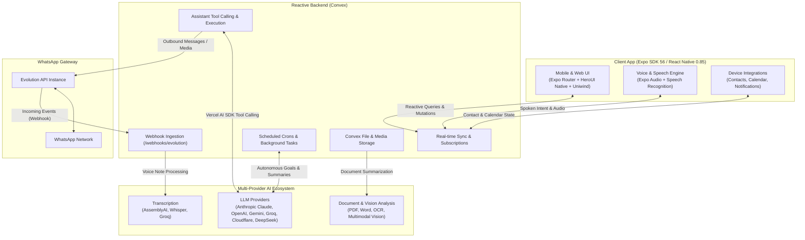

# Bimi

<p align="center">
  <strong>Your smart WhatsApp assistant and personal communication copilot.</strong><br>
  Built with Expo SDK 56 (React Native 0.85), Convex reactive backend, and pluggable AI providers.
</p>

<p align="center">
  <a href="https://github.com/Kwameeh/bimi/actions/workflows/ci.yml"></a>
  <a href="LICENSE"></a>
  <a href="https://docs.expo.dev/"></a>
  <a href="https://reactnative.dev/"></a>
  <a href="https://convex.dev/"></a>
  <a href="https://www.typescriptlang.org/"></a>
</p>

---

## Overview

Bimi unifies your WhatsApp communications with an intelligent, context-aware AI assistant. Instead of switching between chat apps, note-taking tools, and task managers, Bimi continuously processes conversations to draft intelligent replies, track action items, schedule follow-ups, and synthesize insights across multiple chats—all while keeping you in complete control through human-in-the-loop approvals.

> [!IMPORTANT]
> **Deployment Scope**: Bimi currently targets a **trusted, single-user deployment**. All API keys and provider secrets remain securely isolated on your Convex backend. Read [SECURITY.md](SECURITY.md) before connecting real WhatsApp accounts.

---

## System Architecture



---

## Key Features

- **Context-Aware Chat Assistant**: Multi-turn AI assistant with tool calling that retrieves chat histories, queries contacts, drafts replies, and manages calendars.
- **Human-in-the-Loop Safeguards**: Destructive or outbound actions (sending messages, deleting tasks, setting reminders) render **Allow / Deny confirmation cards** before executing.
- **Cross-Chat Intelligence**: Query across multiple WhatsApp chats simultaneously (`askAcrossChats`) to find mentions, consensus, and action items with cited sources.
- **Autonomous Contact Goals**: Set ongoing goals for contacts (e.g., event planning, follow-ups) with configurable cadence and manual or auto-pilot dispatch modes.
- **Deep Multimodal Processing**: Automatic transcription of WhatsApp voice notes, visual analysis of images, and extraction of document attachments (PDF, DOCX).
- **Zero Vendor Lock-In**: Choose runtime providers for LLMs, vision, and speech independently via [convex/providers/](convex/providers/).
- **Voice-First Experience**: Voice conversation mode with natural-language intent classification, stop-word safeguards, and hands-free approval triggers.

---

## Code Quality & Engineering Rigor

Bimi is built to showcase production engineering standards:

- **Zero Linter Warnings**: Strict ESLint configuration with 0 errors and 0 warnings, adhering to React 19 and React Compiler purity standards.
- **430+ Passing Tests**: Comprehensive test suite covering provider routing, tool-calling contracts, speech intent parsers, contact synchronizers, and mutation safety.
- **Strict TypeScript**: 100% type-checked (`tsc --noEmit`) with strict compiler settings.
- **Clean Architecture**: Decoupled domain models, reactive Convex patterns without table scans, and modular provider adapters.

---

## Quick Start

### Prerequisites

- **Node.js**: `v22.13.0` or higher
- **Bun**: `1.3.14` or higher
- **Convex Account**: [convex.dev](https://convex.dev)
- **Evolution API**: An active [Evolution API](https://evolution-api.com) instance connected to WhatsApp

### 1. Installation

```sh
git clone https://github.com/Kwameeh/bimi.git
cd bimi
bun install --frozen-lockfile
```

### 2. Configure Client Environment

Copy `.env.example` to `.env.local`:

```sh
# macOS / Linux
cp .env.example .env.local

# Windows (PowerShell)
Copy-Item .env.example .env.local
```

### 3. Initialize Convex Backend

Start Convex in development mode:

```sh
bunx convex dev
```

Set the backend configuration variables output by Convex in your `.env.local`:

- `EXPO_PUBLIC_CONVEX_URL`: Your deployment URL (e.g., `https://happy-otter-123.convex.cloud`)
- `EXPO_PUBLIC_CONVEX_SITE_URL`: Your HTTP actions URL (e.g., `https://happy-otter-123.convex.site`)
- `EXPO_PUBLIC_BIMI_INSTANCE`: Your Evolution API instance identifier

### 4. Configure Backend Provider Secrets

Configure your messaging gateway and AI provider secrets in the Convex dashboard or via CLI:

```sh
bunx convex env set EVOLUTION_API_BASE_URL "https://your-evolution-api.com"
bunx convex env set EVOLUTION_API_KEY "your-evolution-key"
bunx convex env set EVOLUTION_WEBHOOK_SECRET "your-secure-webhook-secret"
```

#### Choose Your Text AI Provider (`BIMI_AI_PROVIDER`)

Bimi supports **DeepSeek, Anthropic, OpenAI, Groq, Google Gemini, Cloudflare, and OpenAI-compatible** backends:

```sh
# Example A: DeepSeek (All-in-one setup)
bunx convex env set BIMI_AI_PROVIDER "deepseek"
bunx convex env set DEEPSEEK_API_KEY "your-deepseek-api-key"
bunx convex env set DEEPSEEK_MODEL "deepseek-chat"

# Example B: Anthropic Claude
bunx convex env set BIMI_AI_PROVIDER "anthropic"
bunx convex env set ANTHROPIC_API_KEY "your-anthropic-key"
bunx convex env set ANTHROPIC_MODEL "claude-3-5-sonnet-latest"

# Example C: Groq (Ultra-fast inference)
bunx convex env set BIMI_AI_PROVIDER "groq"
bunx convex env set GROQ_API_KEY "your-groq-key"
bunx convex env set GROQ_MODEL "llama-3.3-70b-versatile"
```

> [!TIP]
> **Task-Specific Models**: By default, your primary model (`DEEPSEEK_MODEL`, `ANTHROPIC_MODEL`, etc.) powers all operations. You can optionally route individual tasks to faster or cheaper models:
>
> - `BIMI_AI_REPLY_MODEL`: Model for WhatsApp reply drafts
> - `BIMI_AI_SUMMARY_MODEL`: Model for daily briefings and conversation digests
> - `BIMI_AI_JSON_MODEL`: Model for memory extraction and autonomous contact goal decisions
>
> Read [docs/ai-providers.md](docs/ai-providers.md) for multi-provider and multimodal setups.

Configure your Evolution API webhook URL to point to:
`https://<YOUR_CONVEX_SITE_URL>/webhooks/evolution`
with the header `x-bimi-webhook-secret: <YOUR_WEBHOOK_SECRET>`.

### 5. Launch the Client

```sh
bun run start
```

For native platform builds with device capabilities:

```sh
bun run android    # Android emulator or connected device
bun run ios        # iOS simulator (macOS required)
bun run web        # Web browser preview
```

---

## Verification & Testing

Run the automated verification suite:

```sh
# Check code formatting (Prettier)
bun run format:check

# Validate TypeScript types
bun run typecheck

# Check linter rules (0 errors, 0 warnings enforced)
bun run lint

# Run all 430+ unit and integration tests
bun run test
```

---

## Project Structure

```
bimi/
├── .github/                # GitHub Actions workflows & issue templates
├── assets/                 # App icons, splash screens, and static assets
├── convex/                 # Convex backend schema, mutations, actions, and crons
│   ├── providers/          # AI, transcription, and Evolution API adapters
│   ├── assistantTools.ts   # Assistant tool definitions & input schemas
│   ├── assistant.ts        # Chat execution, tool calling, and action confirmation
│   ├── voiceText.ts        # Voice intent classification & spoken copy
│   └── schema.ts           # Convex reactive database schema & indexes
├── docs/                   # In-depth architectural & provider documentation
├── src/
│   ├── app/                # Expo Router screens (Tabs, Chat, Contacts, Tasks, etc.)
│   ├── components/         # Reusable UI, assistant cards, chat bubbles, and modals
│   ├── hooks/              # Custom React hooks (theme, selection, keyboard)
│   ├── lib/                # Speech, AI modes, calendar, and formatting utilities
│   └── services/           # Device contact synchronization & platform services
├── vitest.config.ts        # Vitest configuration for client & backend testing
└── package.json            # Scripts, Expo SDK 56, and runtime dependencies
```

---

## Documentation

- [System Architecture](docs/architecture.md): Data flows, schema structure, and execution lifecycles.
- [AI Providers & Routing](docs/ai-providers.md): Configuration guides for Anthropic, OpenAI, Gemini, Groq, Cloudflare, and AssemblyAI.
- [Contributing Guide](CONTRIBUTING.md): PR processes, code conventions, and testing requirements.
- [Security Policy](SECURITY.md): Threat model, credential boundaries, and vulnerability reporting.
- [Code of Conduct](CODE_OF_CONDUCT.md): Contributor Covenant v2.1 community guidelines.

---

## License

This project is open-source software licensed under the [Apache License 2.0](LICENSE).
