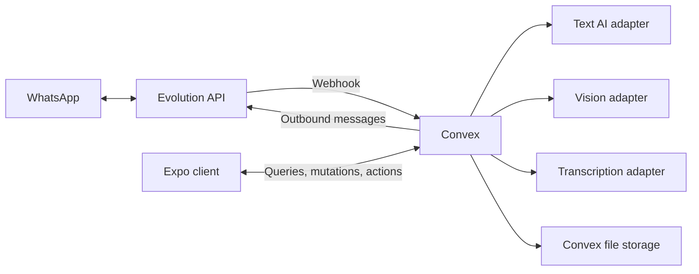

# Bimi architecture

Bimi is one Expo client and one Convex backend. Evolution API connects the backend to WhatsApp. AI vendors are selected behind backend adapters. This describes the current implementation.

`convex/http.ts` accepts Evolution webhooks at `/webhooks/evolution`, normalizes events, and schedules processing. Messages, contacts, tasks, meetings, summaries, and memory live in Convex tables. Media can be fetched from Evolution and stored through Convex file storage. There is no active R2 adapter.

Processing policies determine whether analysis happens automatically or only on request. `manualMediaProcessing.ts` prepares media for explicit AI actions. Background jobs and interactive features share provider entry points.

The assistant uses AI SDK tool calling and streams results into assistant messages. Read tools retrieve context; write tools queue confirmation cards and dispatch after approval. Reply and automation settings govern other message workflows.

## Source layout

| Path                                      | Purpose                                                    |
| ----------------------------------------- | ---------------------------------------------------------- |
| `src/app/`                                | Expo Router screens and layouts                            |
| `src/components/`                         | Shared and feature UI                                      |
| `src/lib/`, `src/hooks/`, `src/services/` | Client integrations, speech, calendar, contacts, and hooks |
| `convex/schema.ts`                        | Backend tables and indexes                                 |
| `convex/assistant*.ts`                    | Assistant orchestration, tools, and streaming              |
| `convex/providers/`                       | AI, transcription, and Evolution adapters                  |
| `convex/media.ts`                         | Media orchestration                                        |
| `convex/**/*.test.ts`                     | Backend and provider tests                                 |

## Providers and deployment

Text AI supports Cloudflare, OpenAI, Anthropic, Google, Groq, DeepSeek, and OpenAI-compatible servers. A server-side catalog exposes configured models to the client. Conversation IDs identify the provider; older Cloudflare model IDs remain valid.

Vision and transcription are independent. Text-only services can be paired with another vision provider and Whisper or AssemblyAI transcription. Speech synthesis currently uses Cloudflare with a device fallback. See [AI providers](ai-providers.md) for settings and extension points.

Vendor credentials stay on Convex. Public Expo variables identify the backend and WhatsApp instance. EAS account identity and application identifiers can be supplied through `app.config.ts` environment settings.

This remains a trusted single-user application. Instance filtering does not provide authorization. Authentication and server-side ownership checks remain separate work; [SECURITY.md](../SECURITY.md) describes the current scope.

The project is licensed under Apache 2.0.
